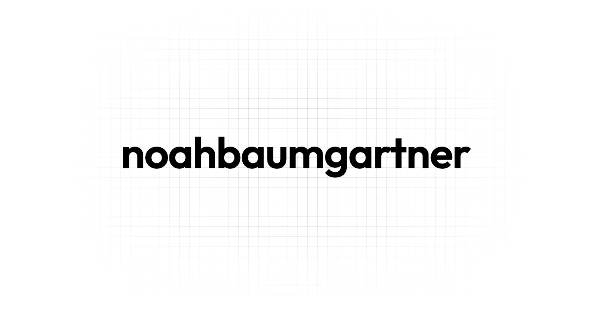

# Portfolio

Source code of my personal portfolio, live at [noahbaumgartner.ch](https://noahbaumgartner.ch). It presents who I am and my professional background, and collects my projects and other work as posts: websites and apps as well as coursework from my studies. The site content is written in German.

## About the site

The site consists of the following pages:

- Start (`/`): an animated hero with a short introduction, a preview of the about page and the latest posts.
- Über mich (`/about`): introduction, work experience, hobbies and education as timelines.
- Beiträge (`/posts`): overview of all posts, filterable by category (projects or studies) and searchable by title and description.
- Beitrag (`/posts/[slug]`): a single post with a table of contents, sources and navigation to the previous and next post.
- Impressum (`/imprint`): legal notice.

### Posts

Posts are Markdown files in `src/content/posts/`. They are compiled with [mdsvex](https://mdsvex.pngwn.net/), so Svelte components can be used inside the text, and math is rendered with KaTeX.

Each post defines its metadata (title, description, year, month, category, icon, accent colors, optional links and sources) in YAML frontmatter.

### Features

- Light and dark theme, following the system setting until the visitor picks one.
- Animated hero sections and mesh gradients as post previews.
- Responsive layout for phones, tablets and desktops.
- Web analytics with Vercel Analytics.

## Technology stack

- Framework: SvelteKit 5 (Svelte runes)
- Language: TypeScript
- Content: Markdown with mdsvex, remark-math and KaTeX
- UI: [`@noahbaumgartner/svelte-ui`](https://www.npmjs.com/package/@noahbaumgartner/svelte-ui) component library and [Lucide](https://lucide.dev) icons
- Styling: component-scoped CSS with a shared color token system
- Tooling: Vite+ for development, build, formatting (Oxfmt) and linting (Oxlint)
- Package manager: npm
- Runtime: Node.js v26
- Deployment: Vercel

## Project structure

```
src/
  content/posts/   Markdown posts
  lib/sections/    Page sections composed by the routes
  lib/services/    Post loading and sorting
  routes/          Pages (/, /about, /posts, /posts/[slug], /imprint)
static/            Fonts, images and videos
```

## Getting started

Follow these instructions to get a local copy of the project up and running.

### Prerequisites

- Node.js: version 26 or higher. Verify with `node -v`.
- npm: ships with Node.js. Verify with `npm -v`.

### Local development

1. Clone the repository.
2. Install dependencies: `npm install`
3. Start the dev server: `npm run dev`

### Scripts

| Command           | Description                        |
| ----------------- | ---------------------------------- |
| `npm run dev`     | Start the development server       |
| `npm run build`   | Create a production build          |
| `npm run preview` | Preview the production build       |
| `npm run check`   | Type check with svelte-check       |
| `npm run format`  | Format the code                    |
| `npm run lint`    | Check formatting and lint the code |

### Production build

1. Build the project: `npm run build`
2. Preview the build: `npm run preview`
